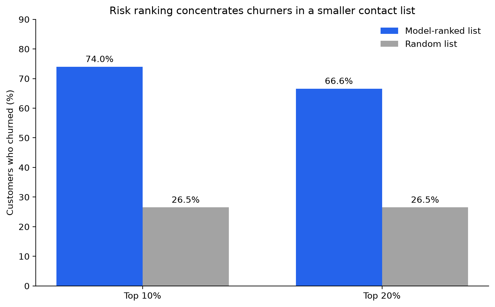

# Beyond Churn Accuracy: Capacity-Aware Customer Triage

## Project question

If a telecom team can review only 10% of its customers, how well can a churn-risk model prioritize that review list?

This project evaluates customer ranking under a limited contact capacity. It compares the churn rate in the model-ranked list with the rate expected from selecting customers at random.

## Key result

On one stratified 25% holdout split, the logistic regression model ranked churners toward the top of the list:

| Review capacity | Customers reviewed | Churners in list | Share of test churners captured | Churn rate in list | Lift over random |
|---|---:|---:|---:|---:|---:|
| Top 10% | 177 | 131 | 28.1% | 74.0% | 2.79× |
| Top 20% | 353 | 235 | 50.3% | 66.6% | 2.51× |

The model's ROC-AUC was **0.847** and average precision (PR-AUC) was **0.638**. The test-set churn rate was **26.5%**.



## Method

- Cleaned the 11 blank `TotalCharges` values as zero because those records have zero tenure.
- Excluded `customerID` from model features.
- Used a stratified train/test split, with 25% held out.
- Fit a logistic regression model with scaled numeric features and one-hot encoded categorical features.
- Measured the share of churners captured and churn rate in the highest-risk 10% and 20% of the test set.
- Compared those lists with random selection, whose expected churn rate is the test-set average.

## Interpretation and limitations

This is a retrospective ranking analysis using an IBM sample dataset, not a live customer system. The results show how well the model ranked customers whose churn outcomes are already recorded.

The dataset does not show whether contacting a customer would prevent churn. A high churn score is not evidence that a retention offer will work, and the monthly charge is not the same as revenue saved. The result also comes from one random holdout split; it should be checked across repeated splits before relying on it.

## Data source

IBM Telco Customer Churn sample data: [IBM repository](https://github.com/IBM/telco-customer-churn-on-icp4d).

Download the CSV into `data/telco_churn.csv` before running the notebook:

```powershell
Invoke-WebRequest -Uri "https://raw.githubusercontent.com/IBM/telco-customer-churn-on-icp4d/master/data/Telco-Customer-Churn.csv" -OutFile "data/telco_churn.csv"
Open and run `01_churn_analysis.ipynb` from top to bottom in VS Code.